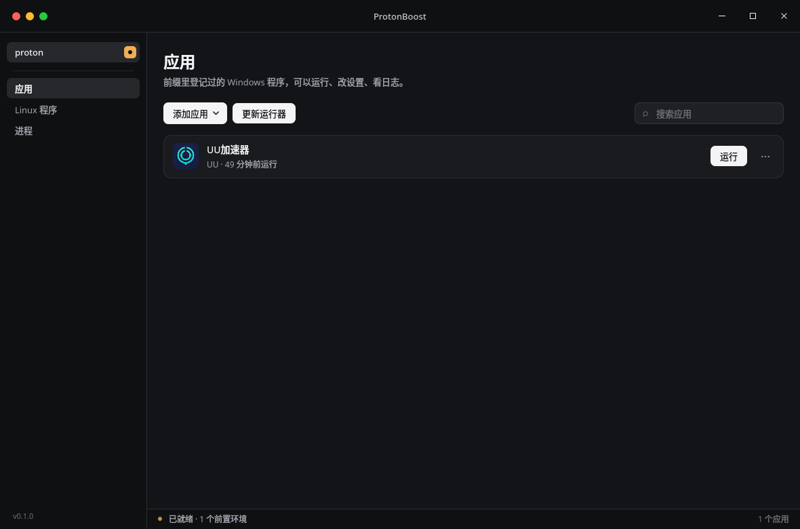

<div align="center">


# ProtonBoost

**在 Linux 上跑 Windows 程序：Proton / Wine 打底，加速器与游戏同网**

*A small Windows program runner for Linux, built on Proton/Wine. GUI in Rust + Qt 6.*

[](https://github.com/xinghui79/protonboost/releases/latest)
[](LICENSE)
[](https://archlinux.org)
[](https://www.rust-lang.org)
[](https://www.qt.io)



</div>

---

把一个 exe 拖给 ProtonBoost，它在默认前缀里建好环境就跑。整套实现是
Rust + Qt 6（cxx-qt + QML），没有脚本、没有 Python，装完就是一个二进制 + 一个图标。
最有意思的部分：**把 Windows 加速器和游戏放进同一个网络命名空间**——加速器接管
的就是游戏真正走的网络。

## ✨ 功能

- **开箱即用**：exe 拖进窗口，前缀自动初始化；首次点一次「下载运行器」即可
- **前缀与运行器**：自动发现 Steam、Lutris、本地目录里的 Proton / Wine，逐个程序选运行器；
  默认前缀 `~/.local/share/protonboost/proton`，老的 `~/.proton` 自动沿用
- **运行设置**：每个程序可单独配 Gamescope（全屏 / 分辨率 / FPS / FSR）、MangoHud、
  Wayland、程序参数、自定义环境变量与 Steam AppID
- **独立网络**：前缀一键开关 network namespace（pasta），Linux 程序自动降权、
  D-Bus 会话桥、Steam 客户端端口转发、fcitx5 联动——细节见 [docs/DESIGN.md](docs/DESIGN.md)
- **图形管理器**：应用 / Linux 程序 / 进程三个页面，右侧检查器，可重命名、
  导出桌面入口、强制结束进程
- **命令行入口**：`--run`（桌面入口）、`--configure`（运行设置）、`--exec`（Steam 启动选项）

## 📦 安装

**Arch**（从 Release 直装）：

```bash
curl -LO https://github.com/xinghui79/protonboost/releases/latest/download/protonboost-0.1.1-1-x86_64.pkg.tar.zst \
  && sudo pacman -U protonboost-0.1.1-1-x86_64.pkg.tar.zst
```

**Debian / Ubuntu**：

```bash
curl -LO https://github.com/xinghui79/protonboost/releases/latest/download/protonboost_0.1.1_amd64.deb \
  && sudo apt install ./protonboost_0.1.1_amd64.deb
```

**其它发行版**：下载 [便携包](https://github.com/xinghui79/protonboost/releases/latest)，
解压后 `./install.sh`（装到 `~/.local`，不需要打包工具）。

**从源码构建**：

```bash
git clone https://github.com/xinghui79/protonboost && cd protonboost
./install.sh            # 构建 release 并安装到 ~/.local
```

> 构建依赖：Rust、Qt 6（`qt6-base` `qt6-declarative` `qt6-svg`）、`cc`。
> 运行时：`passt`（独立网络）、`util-linux`、`curl` + `tar`。
> 可选：`wine`、`gamescope`、`mangohud`。
>
> **为什么不发 Flatpak / AppImage**：工具要调用宿主上的 Proton（pressure-vessel
> 在沙盒里起不来），还要读写 Steam 的 `compatibilitytools.d` 和前缀目录，
> 沙盒化之后要么权限全开要么跑不起来。

<details>
<summary><b>📦 各发行版打包文件</b></summary>

```bash
# Arch / pacman（含 AUR 材料）
cd packaging && makepkg -si

# Debian / Ubuntu（dpkg-deb 轻量方式）
packaging/deb/build-deb.sh          # 产出 protonboost_<版本>_<架构>.deb
```

AUR 发布材料见 `packaging/`（PKGBUILD + .SRCINFO）。
</details>

## 🚀 使用

```bash
protonboost                        # 图形管理器
protonboost --configure 程序.exe   # 只打开某个程序的运行设置
protonboost --run 程序.exe         # 按保存的配置直接启动
protonboost --exec <命令>          # 在前缀会话里跑一条命令（Steam 启动选项）
protonboost --list-runner          # 列出发现的 Proton / Wine
protonboost --dump-scan [前缀]     # 打印前缀扫描结果，排查界面为什么空
protonboost --doctor               # 环境诊断：缺什么命令、运行器在哪、前缀状态
```

- **右键 exe**：装好之后，文件管理器里右键任意 exe 有「运行Windows软件」和
  「设置Windows软件运行环境」两个动作
- **装 Windows 软件**：setup.exe 之类的安装包用右键动作直接跑，向导和 Windows 上一样
- **Steam 游戏**：启动选项填 `protonboost --exec %command%`，游戏会改在
  ProtonBoost 的前缀里跑，与加速器共享独立网络

关窗口只是收进托盘，进程继续跑；真正退出走托盘右键菜单或 `Ctrl+Q`。

<details>
<summary><b>⌨️ 键盘操作</b></summary>

| 按键 | 作用 |
| --- | --- |
| `Ctrl+1` / `2` / `3` | 切换页面 |
| `↑` / `↓` | 选中上一行 / 下一行 |
| `Enter` | 运行选中的应用 |
| `Ctrl+F` | 搜索 |
| `Esc` | 清空搜索，再按一次收起检查器 |
| `Ctrl+R` | 刷新当前页 |
| `Ctrl+W` | 关闭窗口（有托盘就收进托盘） |
| `Ctrl+Q` | 退出程序 |
</details>

<details>
<summary><b>🗂 数据都在本地</b></summary>

| 位置 | 内容 |
| --- | --- |
| `~/.local/share/protonboost/proton` | 默认前缀（老的 `~/.proton` 自动沿用） |
| `~/.cache/protonboost/associations` | 每个程序的运行设置 |
| `~/.cache/protonboost/logs` | 运行日志与会话日志 |
| `~/.cache/protonboost/icons` | 从 exe/ico 里抠出来的图标（界面缓存） |
| `~/.local/share/applications/protonboost` | 导出的应用桌面入口 |
| `~/.local/share/icons/protonboost/apps` | 导出桌面入口用的图标 |
| `$PREFIX/.protonboost.conf` | 前缀自己的开关（独立网络） |
</details>

## 🌐 独立网络

侧栏把前缀右边的小开关点亮就开了独立网络（等价于写 `netns=1`），下次启动生效。
把 Windows 版加速器（网易 UU 的「路由模式」、雷神的「模式三」）和游戏装进
**同一个前缀**，加速器接管的就是游戏所在的网络；关掉开关回到宿主网络。

加速器请使用 [**WE-Proton**](https://github.com/SHORiN-KiWATA/we-proton) 运行器（管理器内一键下载）——它自带 wintun，
让加速器驱动在 Wine 里能真正建起 TUN；普通游戏的 NDIS 内核驱动在 Wine
里无法工作。Steam 游戏把启动选项设成 `protonboost --exec %command%` 即可
共享同一网络。

<details>
<summary><b>🔧 运行器从哪找</b></summary>

按顺序发现，找到几个就列几个，每个程序可单独选：

| 来源 | 位置 |
| --- | --- |
| 环境变量 | `PROTONBOOST_RUNNER` / `PROTON_GE_PATH` 指向的 proton 或 wine |
| Steam 兼容性工具 | `~/.local/share/Steam/compatibilitytools.d/<名字>/proton`（WE-Proton 在这） |

WE-Proton 上游：[SHORiN-KiWATA/we-proton](https://github.com/SHORiN-KiWATA/we-proton)（基于 GE/DW 魔改，自带 wintun）。
| Steam 官方 Proton | `steamapps/common/Proton *`，含其他 Steam 库 |
| 系统级 / Flatpak | `/usr/share/steam/...`、`~/.var/app/com.valvesoftware.Steam/...` |
| Lutris | `~/.local/share/lutris/runners/{proton,wine}` |
| 本地目录 | `~/.local/share/proton/runners/<名字>/proton` |
| 系统 wine | `PATH` 里的 `wine` |

Proton 系的还需要 Steam Linux Runtime，本机没有的话会自动下载。
</details>

## 🏗 构建

```bash
cargo build --release   # 发布版
```

无头验收（不开窗口也能看界面）：

```bash
QT_QPA_PLATFORM=offscreen QT_QUICK_BACKEND=software \
PROTONBOOST_PAGE=apps PROTONBOOST_SHOT=/tmp/shot.png \
./target/debug/protonboost
```

## 📄 文档与许可

- **架构与设计**（模块职责、独立网络实现细节、启动链路）：[docs/DESIGN.md](docs/DESIGN.md)
- License: [MIT](LICENSE)
